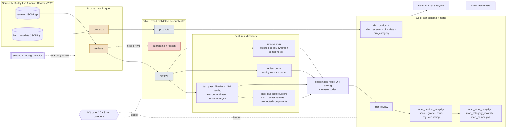
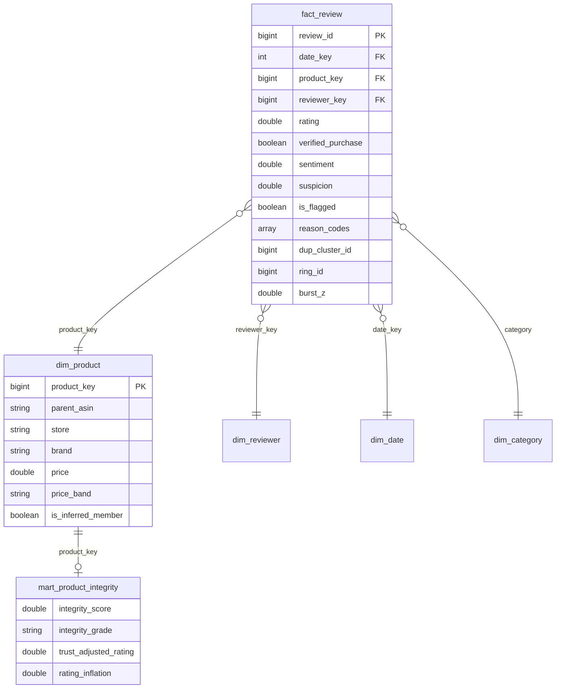

# Amazon Review Integrity Pipeline

A PySpark lakehouse that detects **fake-review campaigns** in the public
[Amazon Reviews 2023](https://amazon-reviews-2023.github.io/) dataset (McAuley Lab), scores every product's
**review integrity**, and recomputes a **trust-adjusted star rating** with suspicious reviews removed.

The dataset has no fraud labels, so the detectors are **evaluated by injecting seeded synthetic campaigns into the
real data**, rerunning the unchanged pipeline, and measuring precision, recall and product-level AUC.

> **Results:** every number about this project comes from a real run and is committed under
> [`docs/results/`](docs/results/). [`RESUME_NUMBERS.md`](docs/results/RESUME_NUMBERS.md) is generated from those
> files and maps each number to its evidence file and JSON key.

## Architecture



## What it detects

| Signal | Method | How it scales |
|---|---|---|
| **Templated campaigns**: near-identical text across accounts | MinHash (64 permutations) on word 3-shingles; LSH with 16 bands × 4 rows (threshold about 0.5); every candidate is checked with **exact Jaccard ≥ 0.6**; clusters via connected components | Bucket members link to the bucket anchor ("star edges"), so candidates grow linearly with bucket size, never quadratically. Avoided comparisons are logged as `pair_reduction_factor`. |
| **Copy-paste reviewers**: same text, one account, ≥3 products | Same near-duplicate clusters, grouped per reviewer | — |
| **Review bursts** | Weekly counts per product, zero-filled; trailing 26-week median/IQR baseline; `robust_z = (x − median) / max(IQR/1.349, √(median+1))` | Only products with ≥20 reviews; window aggregates, no self-joins |
| **Review rings** (lockstep, CopyCatch-style) | Reviewers linked if they hit ≥3 of the same products, each time within 3 days, and those products are ≥50% of the smaller reviewer's catalogue; rings = connected components | Pairs generated only inside (product × 3-day) buckets; oversized buckets are skipped and **counted** |
| **Rating–text mismatch** | Lexicon sentiment with negation handling (e.g. 5★ with negative text, 1★ with glowing text) | Same text pass as MinHash |
| **Incentivized disclosure** | Regex for "received … at a discount in exchange for my honest review" | Same text pass |
| **Behavioural** | Unverified purchase, same-day review sprees | Window functions |

**Chaining guard:** large near-duplicate clusters can chain together organic boilerplate. A review counts as part of a
*templated campaign* only if ≥3 distinct reviewers posted near-identical text **on the same product within ±15 days**,
or the whole cluster (≥3 reviewers) falls inside 30 days.

### Scoring

- **Review suspicion**: an explainable noisy-OR, `1 − Π(1 − wᵢ·xᵢ)` ([weights in config](config/pipeline.toml)).
  Every flagged review carries **reason codes** such as `NEAR_DUP_CAMPAIGN` or `LOCKSTEP_RING`. The DQ gate checks
  that no review is flagged without a reason.
- **Product integrity score** (0–100, graded A–F): `100·(1 − 0.7·flagged_share − 0.3·mean_suspicion)`.
- **Trust-adjusted rating**: the Bayesian average of non-flagged reviews, shrunk toward the category mean. The same
  prior is applied to the raw rating, so `rating_inflation = raw_bayes − trusted_bayes` measures only the effect of
  removing suspicious reviews.
- **Store/brand roll-up** (`mart_store_integrity`): sellers with many low-integrity products.

### A real-data natural experiment

Amazon banned incentivized reviews outside the Vine program on **2016-10-03**. `dim_date.is_post_incentive_ban` and
[`sql/03_incentivized_policy_change.sql`](sql/03_incentivized_policy_change.sql) measure the disclosure rate and the
rating gap before and after the ban.

## Evaluation (no labels → injected ground truth)

[`revint/inject.py`](src/revint/inject.py) copies the real raw file and appends seeded campaigns. Fake accounts use
the real ID format, so detectors cannot key on the ID. Each seed reruns the full pipeline from bronze.

| Campaign type | Shape | Expected difficulty |
|---|---|---|
| TEMPLATE | 15–40 accounts, lightly edited copies of one text on one product, about 1 week (20% heavily edited) | easy |
| REVIEW_BOMB | 1★ near-copies on one product within 4 days | easy |
| RING | 6–12 accounts × 4–8 products, unique texts, plus camouflage reviews on popular products | medium |
| BURST | 25–60 accounts, unique texts, within 5 days | medium |
| SLOW_DRIP | 15–30 accounts, unique texts spread over about 4 months | hard: an honest blind spot |

Metrics ([`eval_report.md`](docs/results/eval/eval_report.md), mean ± std over 3 seeds):

- review recall, overall, per campaign type and per single detector (an ablation);
- **precision lower bound**, where every flagged organic review counts as a false positive even though some are real
  fakes;
- precision on targeted products;
- organic flag rate;
- product AUC and precision@K;
- **rating distortion removed**: how much of the fake-induced rating shift the trust-adjusted rating undoes.

## Data model (gold)



Reviews of products missing from the metadata get **inferred dimension members**, so foreign keys always resolve.
`review_id` is a deterministic xxhash64 surrogate key, because the dataset has no review ID.

## Engineering

- **Incremental loads.** A manifest records the SHA-256 of every raw file. Unchanged files are skipped, a new or
  changed category is the only thing rebuilt, and a rerun with no changes is a no-op.
- **Idempotent writes.** Writes overwrite one category partition at a time. `python -m revint idempotency` reruns
  with `--force` and compares order-independent checksums of 9 gold and feature tables
  ([`idempotency_check.json`](docs/results/idempotency_check.json)).
- **Data-quality gate (20 checks, plus 3 per category).** Error-level failures stop the run:
  - source-line ↔ bronze reconciliation, and silver + quarantine + duplicates = bronze;
  - key uniqueness, rating and timestamp domains;
  - foreign keys fact → date, reviewer and product;
  - score ranges, and fact ↔ mart reconciliation;
  - detector invariants such as edge Jaccard ≥ threshold and burst z ≥ threshold;
  - every flagged review has a reason code.

  Warn-level checks cover the quarantine rate and metadata coverage. Results are in
  [`dq_report_main.json`](docs/results/dq_report_main.json).
- **Run manifest.** Each run records per-stage timings, row counts, detector statistics, storage by layer and the
  machine, Spark and Java versions.
- **Tests and CI.**
  - Unit tests cover MinHash, sentiment, the incentive regex, connected components, bursts, rings and the noisy-OR.
  - End-to-end tests cover the DQ gate, idempotency, the incremental no-op, adding a new category, reprocessing a
    changed file, the gate blocking a corrupted run, and injection plus evaluation.
  - GitHub Actions runs ruff and pytest on Java 17 and Python 3.12.
- **Performance.** A pure Spark SQL higher-order-function MinHash took 145 s per 200K reviews on 2 cores, so the text
  pass is one vectorised **pandas UDF** (NumPy MinHash over Arrow batches) that parses each review once.
- **Connected components without GraphFrames.** Min-label propagation with pointer jumping, on DataFrames with
  local checkpoints. It is deterministic because the component ID is the minimum node ID.

## Quickstart (macOS, Apple Silicon)

```bash
python3.14 -m venv .venv && source .venv/bin/activate
export JAVA_HOME="$(brew --prefix openjdk@17)/libexec/openjdk.jdk/Contents/Home"
pip install -r requirements.txt && pip install -e .

pytest                         # tests run on a synthetic sample in the exact raw format
scripts/run_real.sh            # download → first category → incremental → full run → idempotency → eval → SQL → dashboard → report
open docs/results/dashboard.html
```

Individual commands: `python -m revint run --categories All_Beauty Video_Games --publish`,
`python -m revint eval --category All_Beauty`, `python -m revint sql`, `python -m revint dashboard`,
`python -m revint report`.

## AWS mapping

See [`docs/aws_mapping.md`](docs/aws_mapping.md). **This project runs locally. Nothing has been deployed to AWS.**
That document maps each local component to S3, Glue, EMR, Athena and Redshift, and lists what would change. The
[`infra/`](infra/) files are untested deployment sketches.

## Limitations

- Sentiment is lexicon-based, not a trained model, so the mismatch signal is deliberately weighted low (0.30).
- Bursts are not scored in a product's first 4 weeks, so a launch-day campaign is a blind spot.
- Slow-drip campaigns with unique text are largely missed by design; the evaluation reports this rather than hiding it.
- Detectors run per category, so cross-category templates are not linked.
- Precision is a lower bound because real data contains real fakes that count as false positives.

## Layout

```
src/revint/      ingest · silver · textfeat · detectors/{text_signals,near_dup,burst,rings} · graph · scoring
                 gold · quality · pipeline · inject · evaluate · analytics · dashboard · report · idempotency
sql/             11 analytics queries (window functions, top-N per group, natural experiment)
config/          pipeline.toml (all thresholds and weights) · sample.toml (CI overlay)
tests/           unit + end-to-end (pytest)
docs/results/    committed evidence from real runs
infra/           Redshift / Athena DDL, EMR Serverless job sketch (not executed)
```

Data: Hou et al., *Bridging Language and Items for Retrieval and Recommendation* (2024), Amazon Reviews 2023,
McAuley Lab, UCSD.
